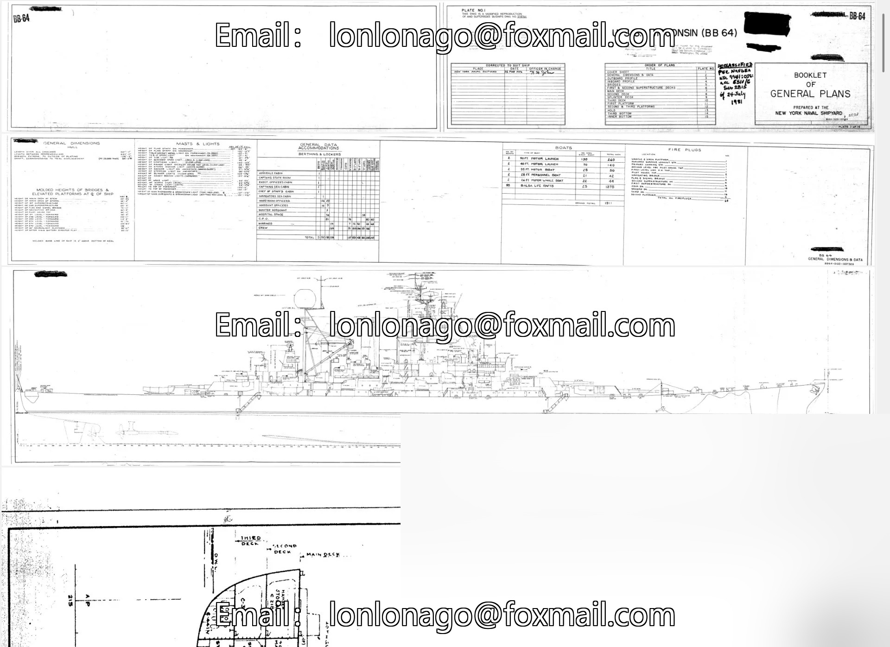
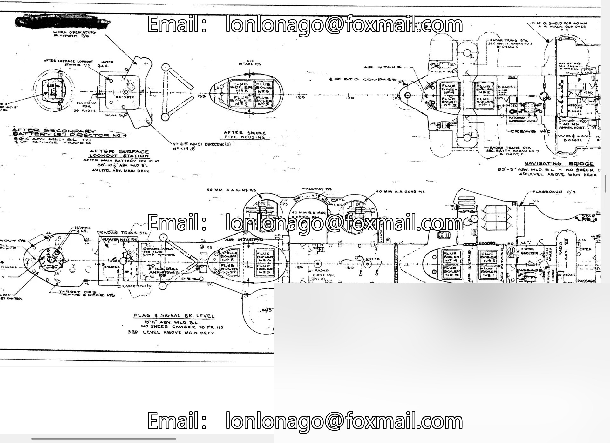
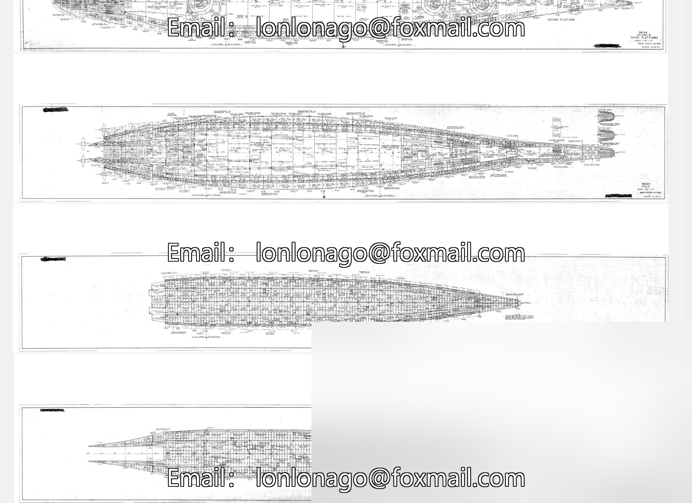

# USS Wisconsin (BB-64) complete electronic drawings

## Body

Complete electronic drawing materials of USS Wisconsin (BB-64) battleship, including detailed technical drawings such as the hull assembly drawing, internal structure plane drawing, cannon position layout, fire control system, and power device, covering core design parameters of American naval battleships in the 1940s.
15 pages
are not refundable and not exchangeable.

This is the complete electronic drawing set for the USS Wisconsin (BB-64) battleship, including hull assembly drawings, internal structure plans, turret layouts, fire control systems and power equipment, covering core design parameters of 1940s American naval battleship design with 15 pages.

<!-- AI_ENRICHED -->

## Images

## Payment

Here is a pay link on Stripe ( https://buy.stripe.com/3cs8yP7sY87d0vu9AB ). Please contact me lonlonago@foxmail.com after funding $89, and I will send you a complete data files , thank you!

